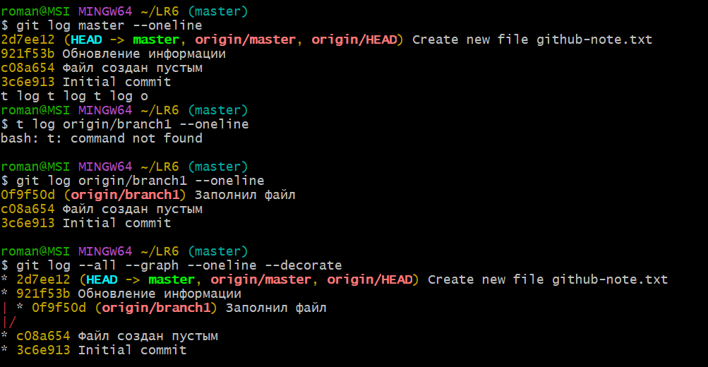
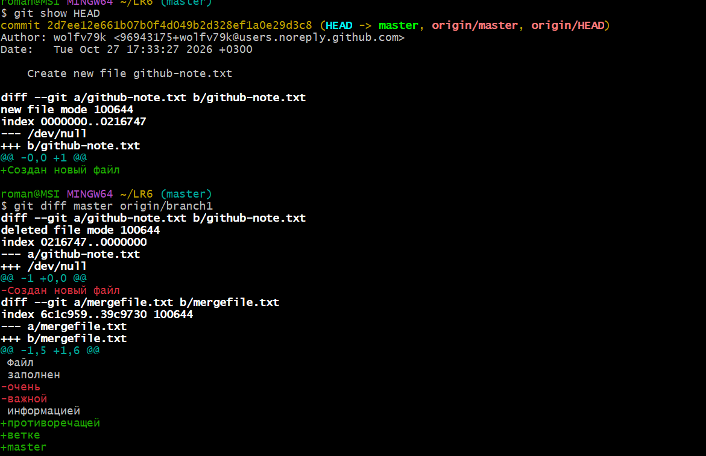
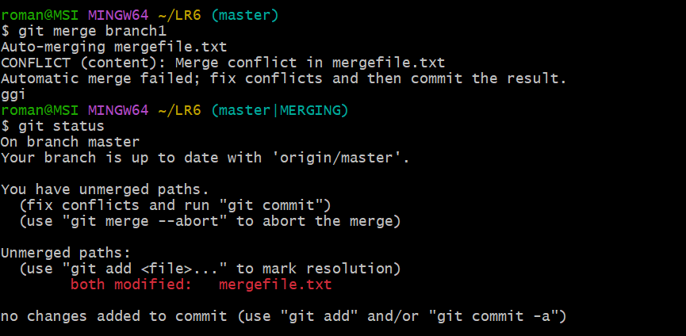
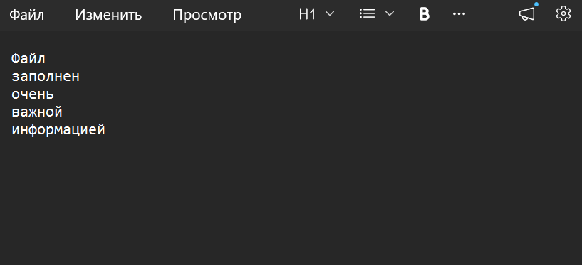
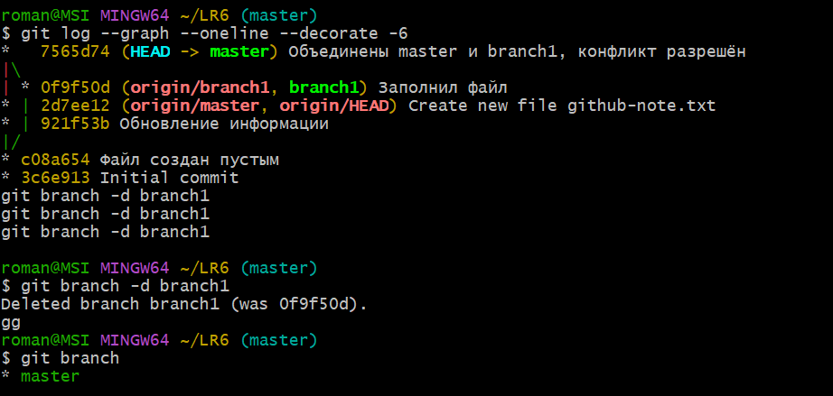
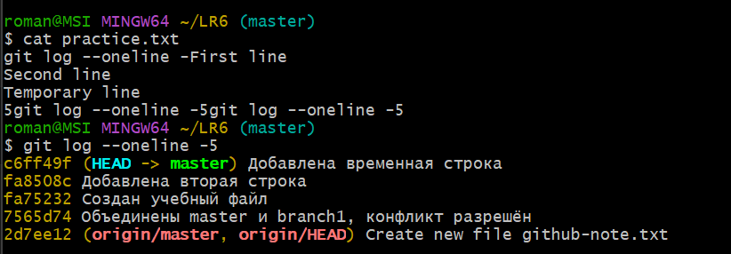
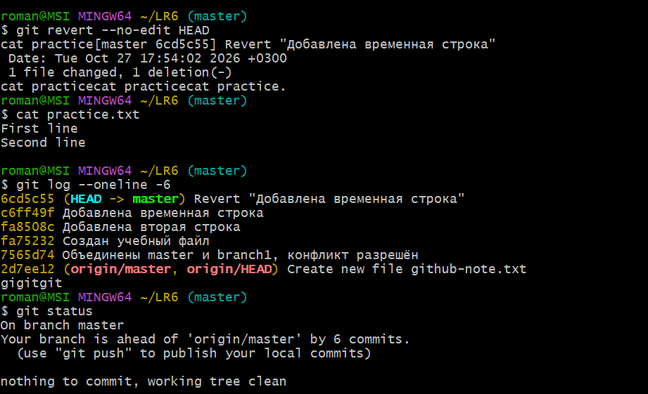
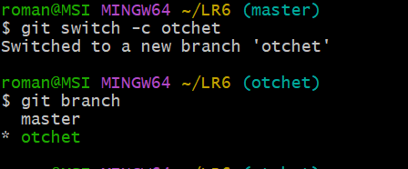

\# ГУАП

\## КАФЕДРА № 44

\*\*ОТЧЕТ\*\*  

\*\*ЗАЩИЩЕН С ОЦЕНКОЙ\*\*

\*\*ПРЕПОДАВАТЕЛЬ\*\*  

старший преподаватель, Т. Р. Мустафин

\# ОТЧЕТ О ЛАБОРАТОРНОЙ РАБОТЕ №6

\## СИСТЕМА КОНТРОЛЯ ВЕРСИЙ

\## по курсу: ОСНОВЫ ПРОГРАММИРОВАНИЯ

\*\*РАБОТУ ВЫПОЛНИЛ\*\* 

\*\*Студент гр. № 4515 Р.Э. Никонёнок\*\* 

\*\*Санкт-Петербург 2026\*\*

\---

\## 1. Цель работы

Изучить базовые возможности системы управления версиями Git, получить опыт работы с локальным и удалённым репозиториями, ветками и историей изменений.

\## 2. Выполнение работы

\### 2.1. Создание личной копии репозитория

Создана учётная запись GitHub. С помощью Fork создана личная копия учебного репозитория Kurtyanik/LR6 с ветками master и branch1.

Адрес личного репозитория: https://github.com/wolfv79k/LR6

!\[Рисунок 1 — Личная копия репозитория на GitHub](screenshots/01-fork.png)

\### 2.2. Установка и настройка Git

Установлен Git для Windows. Заданы имя автора в формате «Группа Фамилия И. О.» и адрес электронной почты. Проверены версия Git и настройки автора.

!\[Рисунок 2 — Версия Git и настройки автора](screenshots/02-settings.png)

\### 2.3. Клонирование репозитория

Личный репозиторий клонирован на компьютер. Проверены адрес удалённого репозитория origin и список веток.

!\[Рисунок 3 — Клонирование, адрес origin и список веток](screenshots/03-clone.png)

\### 2.4. Добавление файла через GitHub и получение изменений

После клонирования через веб-интерфейс GitHub в ветке master создан файл github-note.txt. Изменения получены в локальную копию командой git pull --ff-only origin master. Проверено содержимое полученного файла.

!\[Рисунок 4 — Файл, созданный через GitHub](screenshots/04-github-file.png)

!\[Рисунок 5 — Получение изменений и содержимое файла](screenshots/05-pull.png)

### 2.5. Просмотр истории веток

Просмотрены истории master и origin/branch1, а также общий граф коммитов. По графу определено расхождение веток.

### 2.6. Просмотр последних изменений

Просмотрено содержимое последнего коммита и различия между master и origin/branch1. В mergefile.txt обнаружены разные варианты текста.

### 2.7. Слияние и разрешение конфликта

На основе origin/branch1 создана локальная ветка branch1. Выполнено переключение в master и слияние branch1. В mergefile.txt возник конфликт.

Файл открыт в редакторе. Вручную сформирован итоговый текст, удалены маркеры конфликта. Исправленный файл добавлен в индекс, затем создан коммит завершения слияния.

### 2.8. Удаление побочной ветки

После завершения слияния проверены состояние репозитория и граф истории. Слитая локальная ветка branch1 удалена командой git branch -d branch1.

### 2.9. Последовательные изменения и коммиты

Создан учебный файл practice.txt. В него последовательно записаны строки First line, Second line и Temporary line. Каждое изменение сохранено отдельным коммитом с поясняющим сообщением.

### 2.10. Откат коммита

Командой git revert --no-edit HEAD отменено изменение последнего коммита. Создан новый коммит отмены; исходный коммит остался в истории. Проверено, что в practice.txt остались строки First line и Second line.

### 2.11. Создание ветки для отчёта

Из текущего состояния master создана ветка otchet. Дальнейшее оформление README.md выполняется в этой ветке.

### 2.12. Постепенное оформление README.md

Отчёт оформляется в Markdown. Скриншоты находятся в отдельной папке screenshots и подключены относительными ссылками. Разделы добавляются последовательно; очередная часть сохраняется отдельным коммитом с описанием добавленного материала.

