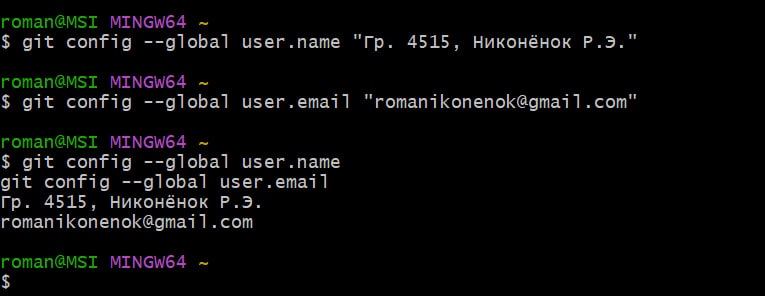
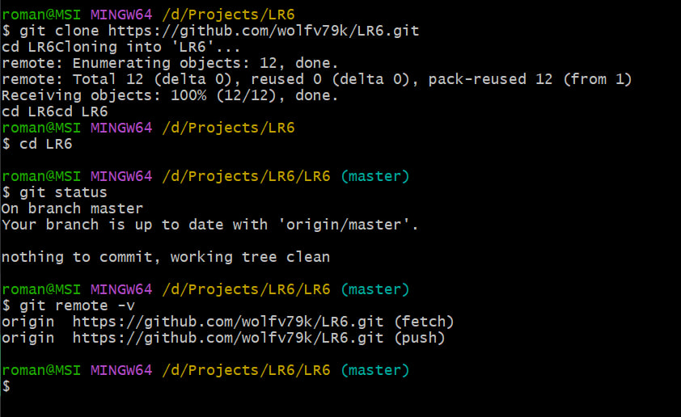
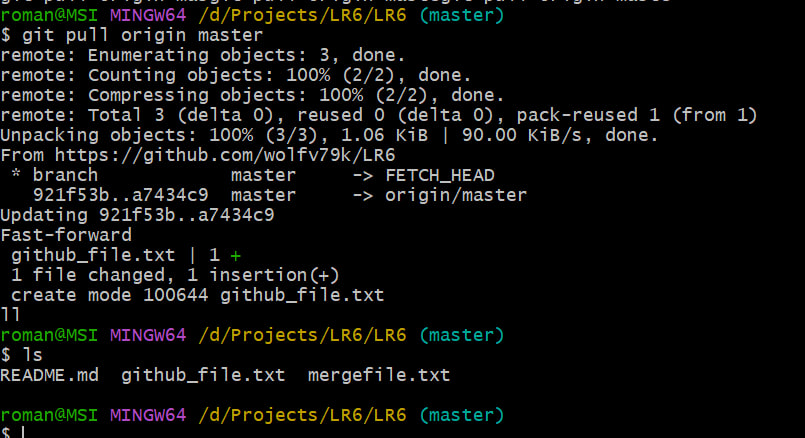
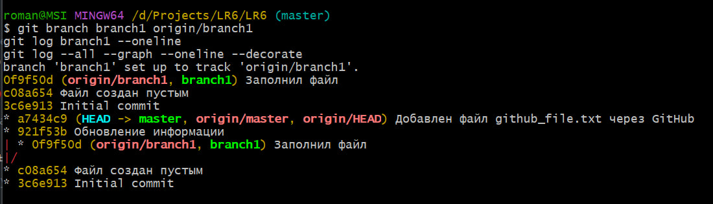
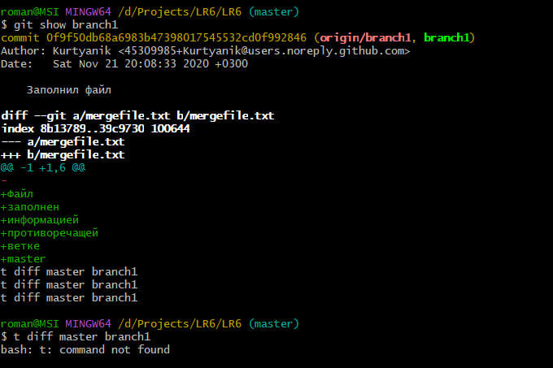
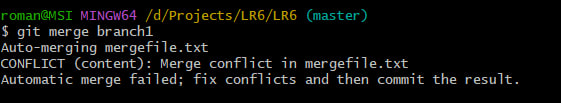
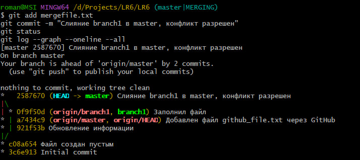
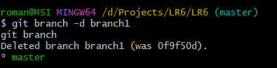
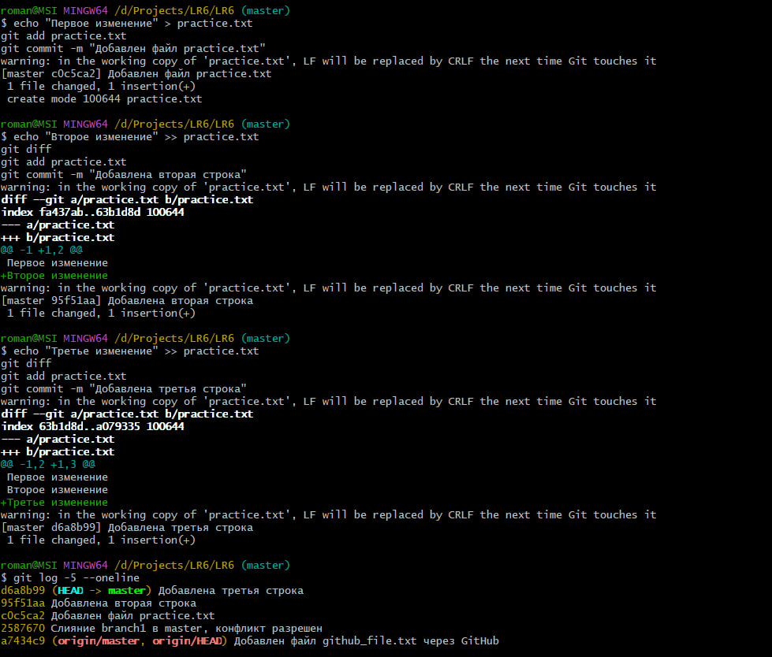
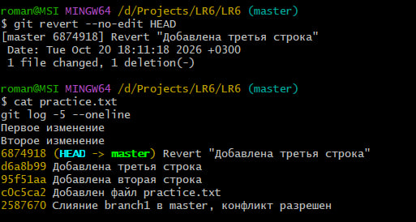

<div align="center">

# ГУАП
## КАФЕДРА № 44

</div>

**ОТЧЕТ**  
**ЗАЩИЩЕН С ОЦЕНКОЙ**

**ПРЕПОДАВАТЕЛЬ**  
старший преподаватель, Т. Р. Мустафин

<div align="center">

# ОТЧЕТ О ЛАБОРАТОРНОЙ РАБОТЕ №6
## СИСТЕМА КОНТРОЛЯ ВЕРСИЙ

## по курсу: ОСНОВЫ ПРОГРАММИРОВАНИЯ

</div>

**РАБОТУ ВЫПОЛНИЛ**<br>
**Студент гр. № 4515 Р.Э. Никонёнок** 


<div align="center">

**Санкт-Петербург 2026**

</div>

---


## Цель работы


Изучить базовые возможности системы контроля версий Git, получить навыки работы с локальным и удалённым репозиториями, ветками, коммитами и конфликтами слияния.


## Ход работы


### 1. Создание аккаунта и копирование репозитория


На GitHub создана личная копия учебного репозитория `Kurtyanik/LR6` с помощью операции Fork.


Адрес личного репозитория: https://github.com/wolfv79k/LR6


### 2. Установка и настройка Git


Установлена система контроля версий Git. В настройках указаны группа, фамилия и инициалы автора, а также электронная почта.


Проверены версия Git и заданные настройки.





### 3. Клонирование репозитория


Личный репозиторий склонирован на компьютер в папку `D:ProjectsLR6LR6`.


С помощью команд `git status` и `git remote -v` проверены состояние рабочей папки и адрес удалённого репозитория.


Текущая ветка — `master`. Удалённый репозиторий обозначен именем `origin`.





### 4. Получение изменений с GitHub


Через веб-интерфейс GitHub в ветке `master` создан файл `github_file.txt`. Изменение сохранено коммитом.


Затем командой `git pull origin master` изменения загружены в локальный репозиторий. Проверено появление файла в рабочей папке.





### 5. Просмотр истории веток


На основе `origin/branch1` создана локальная ветка `branch1`.


Просмотрена история коммитов веток `master` и `branch1`. Также построен общий граф истории с помощью команды:


```bash

git log --all --graph --oneline --decorate

```


На графе видно, что ветки имеют общие начальные коммиты, после которых история изменений расходится.





### 6. Просмотр последних изменений


С помощью `git show` просмотрены последние коммиты обеих веток.


Командой `git diff master branch1` получены различия между ветками. Обнаружены разные варианты содержимого файла `mergefile.txt`.





### 7. Слияние веток и разрешение конфликта


В ветке `master` выполнена команда:


```bash

git merge branch1

```


При слиянии возник конфликт в файле `mergefile.txt`, поскольку в ветках содержались разные изменения одних и тех же строк.





Файл открыт в текстовом редакторе. Выбран итоговый вариант содержимого и удалены маркеры конфликта `<<<<<<<`, `=======` и `>>>>>>>`.


После сохранения файла выполнены команды:


```bash

git add mergefile.txt

git commit -m "Слияние branch1 в master, конфликт разрешен"

```


Конфликт разрешён, слияние завершено.





### 8. Удаление побочной ветки


После успешного слияния локальная ветка `branch1` удалена командой:


```bash

git branch -d branch1

```


Коммиты этой ветки сохранены в общей истории репозитория.





### 9. Создание нескольких коммитов


В ветке `master` создан файл `practice.txt`. Последовательно выполнены три изменения: создание файла, добавление второй строки и добавление третьей строки.


Каждое изменение сохранено отдельным коммитом с поясняющим сообщением.





### 10. Отмена последнего коммита


Выполнена команда:


```bash

git revert --no-edit HEAD

```


Создан новый коммит, отменяющий последнее изменение. Третья строка удалена из файла `practice.txt`, при этом исходный коммит остался в истории.





### 11. Создание ветки для отчёта


Командой `git switch -c report` создана отдельная ветка `report`.


В этой ветке оформлен отчёт в файле `README.md` с использованием Markdown. Скриншоты размещены в папке `screenshots`, а список выполненных команд — в файле `commands.txt`.


Во время подготовки отчёта изменения сохранялись отдельными коммитами с поясняющими сообщениями.


## Лог команд


Список фактически выполненных команд без результатов их выполнения приведён в файле [commands.txt](commands.txt).


## Форматированная история коммитов


История получена командой:


```bash

git log --all --date=short --pretty=format:"%h | %ad | %an | %s"

```


Каждая строка содержит сокращённый хэш коммита, дату, имя автора и комментарий.


```text

ВСТАВИТЬ СЮДА ФАКТИЧЕСКИЙ ВЫВОД КОМАНДЫ

```


## Вывод


В ходе лабораторной работы изучены основные операции Git: клонирование репозитория, получение удалённых изменений, просмотр истории, работа с ветками, слияние и разрешение конфликта.


Получены навыки создания коммитов и отмены изменений с сохранением истории. Отчёт оформлен с использованием Markdown.

